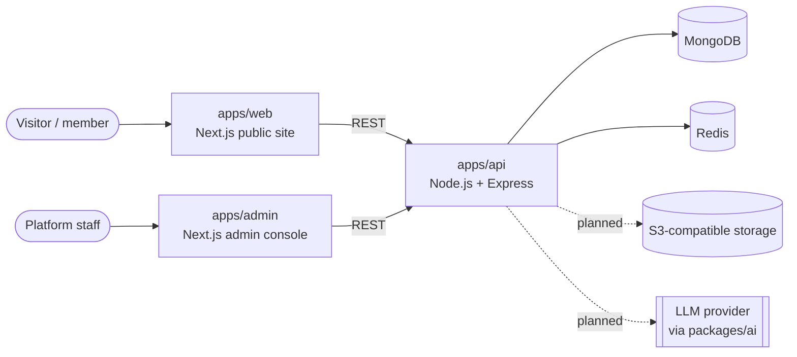

# System Architecture

Status: **Phase 1 — foundation.** Only health endpoints and the public shell exist. Everything marked
_planned_ is design intent, not implemented behaviour.

## Context



## Components

| Component             | Technology                             | Responsibility today                                                       |
| --------------------- | -------------------------------------- | -------------------------------------------------------------------------- |
| `apps/web`            | Next.js 16, React 19, Tailwind CSS 4   | Public marketing shell, nine legal placeholders, sitemap/robots, nonce CSP |
| `apps/admin`          | Next.js 16                             | Separate, non-indexable placeholder; no functionality until auth exists    |
| `apps/api`            | Node.js 22, Express 5, TypeScript      | `GET /health`, `/health/database`, `/health/redis`; security middleware    |
| `packages/config`     | Zod                                    | Environment contracts, brand/navigation config, CSP + security headers     |
| `packages/types`      | TypeScript                             | Cross-app contracts (health results, API error envelope)                   |
| `packages/validation` | Zod                                    | Shared schemas (ObjectId, pagination, health responses)                    |
| `packages/database`   | Mongoose 9                             | Connection helper, append-only `AuditLog` model                            |
| `packages/auth`       | —                                      | **Placeholder** — reserves the boundary for Phase 3                        |
| `packages/ai`         | TypeScript                             | Provider interface + "AI-generated" labelling rule only                    |
| `packages/ui`         | React, Radix Slot, CVA, tailwind-merge | Accessible primitives: `Button`, `SkipLink`, `Container`, `cn`             |

## Request flow (API)

```
request → request-id + structured log → (docs, dev only) → helmet → CORS allow-list
        → /health router (no rate limit)
        → rate limiter → JSON body parser (100 kB cap) → [feature routers, later phases]
        → 404 handler → error handler (JSON envelope, no internals)
```

Every error response uses `{ "error": { "code", "message", "requestId" } }`. Unexpected errors return a
generic 500; details go to the server log only.

## Health endpoints

| Endpoint               | Meaning                                             | Success | Failure |
| ---------------------- | --------------------------------------------------- | ------- | ------- |
| `GET /health`          | Liveness — process is serving; no dependencies      | 200     | —       |
| `GET /health/database` | MongoDB ping (bounded by `HEALTH_CHECK_TIMEOUT_MS`) | 200     | 503     |
| `GET /health/redis`    | Redis `PING` (same timeout)                         | 200     | 503     |

Responses never include hostnames, connection strings or error text. The API starts and stays up when a
dependency is down (it retries MongoDB in the background; ioredis reconnects), so orchestrators can
distinguish "alive" from "ready".

## Multi-tenancy (design intent)

MongoDB has no row-level security, so organization isolation must be enforced in code:

- every tenant-owned document carries `organizationId`;
- all access goes through repository functions that require an organization scope (no raw model access
  from route handlers);
- cross-organization access is covered by automated tests (Phase 3 onward).

## Future international expansion

Locale-aware routing, per-region data residency and translated content are not built yet. The web app
uses `lang="en"` and the config package holds navigation/legal metadata centrally so adding locales does
not require touching each page.

## Open design questions

- **Semantic search / RAG.** The original brief named pgvector. With MongoDB the options are Atlas Vector
  Search or a dedicated vector store; decide before the AI phase (see ADR-001).
- **Background jobs.** Redis is provisioned; the queue library is chosen when the first job is needed.
